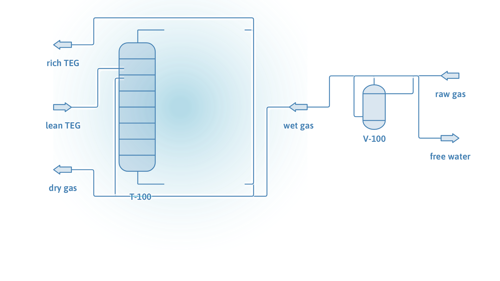
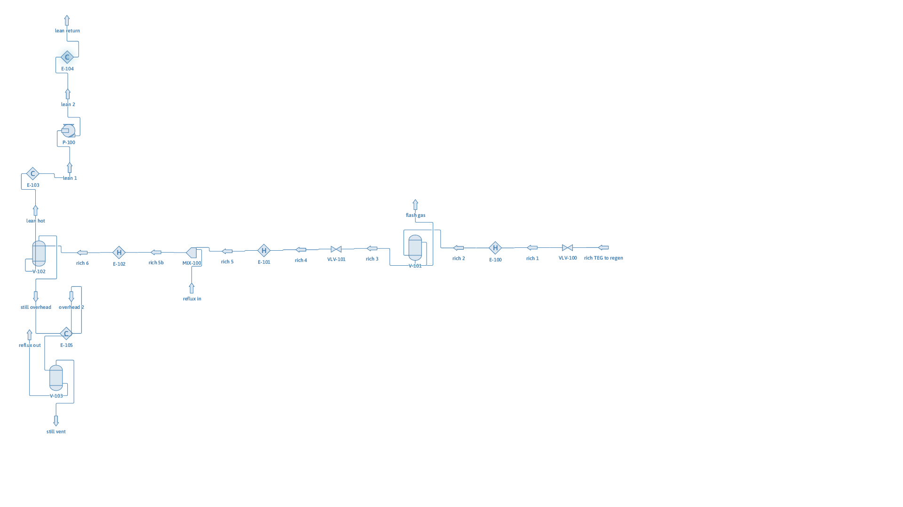
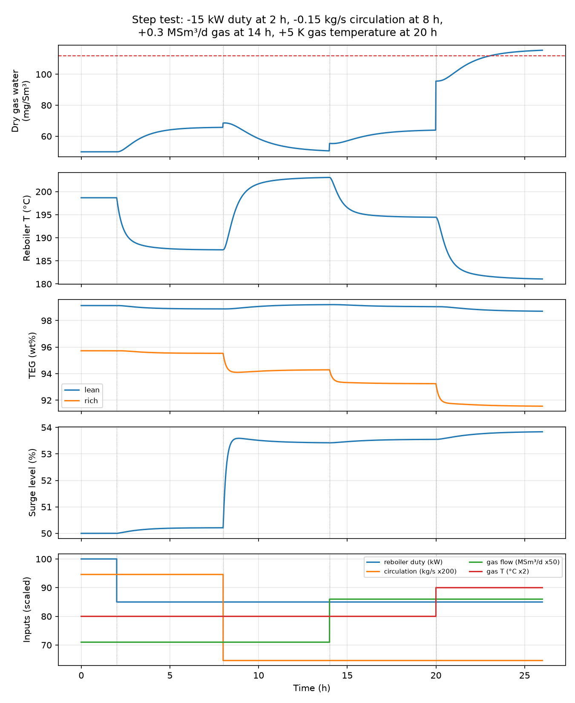

# TEG Gas Dehydration: an Open, Validated Process Model and Dynamic FMU

[](https://doi.org/10.5281/zenodo.23874675)

An open-source model of a triethylene glycol (TEG) dehydration unit for a Queensland coal-seam gas
stream, built with [DWSIM](https://dwsim.org), Python and Modelica. It has two layers:

1. **Steady-state process model** (DWSIM): calibrated thermodynamics, full unit, design optimisation.
2. **Reduced-order dynamic model** (Modelica, exported as an FMI 2.0 FMU): ready for control studies,
   for example model predictive control or deep reinforcement learning.

The steady-state study answers a plant question:

> **Which TEG circulation rate and reboiler temperature meet the pipeline water spec at the lowest energy?**

Everything is reproducible from public data. Each step is one script and one double-click `.bat` file.

## Key findings

| | Result |
| --- | --- |
| Default thermodynamics fail | DWSIM's default Peng-Robinson parameters predict gas over 99 wt% TEG keeps ~930 mg/Sm³ of water, about 10× too high. Used as-is, the design would be wrong. |
| Calibrated model | Three binary parameters fitted to public data: methane-water (3 % mean error vs Bukacek), TEG-water at contactor temperatures (1.3 K dew point RMS) and at regenerator temperatures. |
| Base case | 1.42 million Sm³/d at 7000 kPa, 40 °C; dry gas 52 mg/Sm³ vs the 112 mg/Sm³ limit; lean TEG 99.15 wt%; reboiler 93 kW. |
| What drives dryness | Lean TEG purity (reboiler temperature). Above ~15 L TEG/kg water, extra circulation barely improves dryness. |
| What drives energy | Circulation. The common 3 gal/lb (25 L/kg) rule of thumb is conservative here. |
| Recommendation | ~15 L/kg at 195 °C: 62 mg/Sm³ with margin, about 40 % less reboiler duty than the base case. |


## Process

```
raw gas -> V-100 inlet scrubber -> T-100 TEG contactor -> dry gas
rich TEG -> VLV-100 -> E-100 -> V-101 flash drum (500 kPa) -> VLV-101 -> E-101 lean/rich exchanger
         -> E-102 reboiler -> V-102 still (101 kPa) -> E-105 reflux condenser -> still vent
lean TEG -> E-103 lean/rich exchanger -> P-100 pump -> E-104 cooler -> back to T-100
```

The DWSIM flowsheets are in `flowsheets/` and open directly in the DWSIM interface:

| Contactor section | Regeneration section |
| --- | --- |
|  |  |

## Method

| Step | Script | What it does |
| --- | --- | --- |
| 1 | `01_water_content.py` | Water content of the raw gas; compares PR, SRK and PRSV2 with the Bukacek correlation. |
| 2 | `02_tune_kij.py` | Fits the methane-water kij (default 0.5 → 0.328). |
| 3 | `03_fit_teg_water.py` | Fits TEG-water kij to isobaric VLE data at 85 kPa (regenerator range). |
| 4 | `04_fit_contactor_kij.py` | Fits TEG-water kij to equilibrium dew points over TEG at 10-60 °C (contactor range). |
| 5 | `05_teg_unit.py` | Builds and solves the full unit; closes the lean TEG and reflux loops in Python. |
| 6 | `06_sensitivity.py` | Circulation, reboiler temperature and stage sensitivities; operating window. |
| 7 | `07_reduced_model_data.py` | Fits the relations the dynamic model needs from DWSIM (bubble curve, contactor map). |
| 8 | `08_python_twin.py` | Python twin of the Modelica model; open-loop step test. |
| - | `export_fmu.bat` | Dymola: simulates `TEGDehydration.Examples.StepTest` and exports `modelica/TEGUnit.fmu`. |
| 9 | `09_run_fmu.py` | Runs the FMU with fmpy and compares it with the Python twin. |

TEG-water interaction is strongly temperature dependent (fitted kij −0.265 at 10-60 °C vs −0.146 at 100-150 °C),
so the contactor and the regeneration section are solved as two linked flowsheets, each with its own parameter.

## Dynamic model and FMU

`modelica/TEGDehydration/package.mo` contains `TEGDehydration.TEGUnit`, a reduced-order dynamic model of the
whole unit written with the Modelica Standard Library only.

| | |
| --- | --- |
| Control inputs | `Q_reb` reboiler duty (W), `m_circ` lean TEG circulation (kg/s) |
| Disturbances | `F_gas` gas flow (million Sm³/d), `T_gas` gas temperature (°C) |
| Outputs | `dryGasWater` (mg/Sm³), `T_reboiler` (°C), `leanTEG` and `richTEG` (wt%), `surgeLevel` (0-1), `boilUp` (kg/s) |
| Dynamic states | reboiler/still mass, composition and energy; surge tank level and composition; contactor liquid mixing; rich TEG transport lag |
| From DWSIM | TEG-water bubble curve (max error 3 K) and a contactor performance map (100 runs, mean error 4.6 %) |
| Initialisation | steady state at the initial inputs (`steadyStateInit = true`) |

Open-loop step test (Python twin and FMU agree to within 0.002 K in reboiler temperature):

| Time | Step | Dry gas water | Reboiler T |
| --- | --- | --- | --- |
| 0 h | steady state | 50 mg/Sm³ | 198.7 °C |
| 2 h | duty -15 kW | 66 mg/Sm³ | 187 °C |
| 8 h | circulation -0.15 kg/s | 51 mg/Sm³ | 203 °C |
| 14 h | gas +0.3 million Sm³/d | 64 mg/Sm³ | 194 °C |
| 20 h | gas temperature +5 K | **116 mg/Sm³, off spec** | 181 °C |

The last step shows why the unit needs feedback control: warmer, wetter gas pushes the dry gas off spec at
fixed duty and circulation.



Equipment holdups and time constants (reboiler 550 kg, surge tank 3000 kg, rich TEG lag 10 min, contactor
mixing 3 min) are assumed typical design values, not data from a specific plant.

## Design basis

| Item | Value |
| --- | --- |
| Gas | CH₄ 97.0 %, N₂ 1.5 %, CO₂ 1.0 %, C₂H₆ 0.5 % (mol, dry), water saturated |
| Flow | 1.42 million Sm³/d (about 50 MMscfd) |
| Contactor | 7000 kPa abs, gas 40 °C, lean TEG 45 °C, 4 equilibrium stages |
| Regeneration | flash drum 500 kPa / 65 °C, still 101 kPa, reboiler 200 °C, reflux condenser 102 °C |
| Spec | ≤ 112 mg/Sm³ water (Queensland Gas Pipeline specification, referencing AS 4564) |
| Thermodynamics | Peng-Robinson with fitted kij; standard conditions 15 °C, 101.325 kPa |

## Limitations

- Peng-Robinson with constant kij is a correlative model, not a predictive one. Associating models (CPA) or
  dedicated glycol packages are more rigorous; they are not available in the free DWSIM edition.
- DWSIM absorbers need at least 4 equilibrium stages; real contactors are typically 2-3 theoretical stages,
  so contactor performance may be slightly optimistic.
- Tray hydraulics, minimum wetting rates and TEG degradation are not modelled. Circulation below ~2 gal/lb
  (~17 L/kg) should be checked against hydraulic limits before use.
- No stripping gas; adding it would raise lean TEG purity above the reboiler-limited value.
- The gas composition is representative, not from a specific field.
- The dynamic model uses fitted maps inside their fitted range (lean TEG 98.5-99.7 wt%, TEG/water
  8-36 kg/kg, gas 30-45 °C) and assumed holdups; it is meant for control studies, not equipment design.

## Run it yourself (Windows)

1. Install [DWSIM 10 Open-Source Core Edition](https://dwsim.org/index.php/download/) and Anaconda.
2. Double-click `setup_env.bat` once (creates the conda environment `teg`).
3. Double-click `run_test.bat`, then `run_01_...` to `run_08_...` in order.
   Results go to `results/`, flowsheets to `flowsheets/`.
4. Dynamic model: with Dymola installed, double-click `export_fmu.bat`, then `run_09_run_fmu.bat`.
   The model uses only the Modelica Standard Library 4.0, so it can also be compiled with OpenModelica.
   A Dymola-exported FMU needs a Dymola licence to run unless it was built with the Binary Model Export option,
   so the FMU itself is not included in the repository.

On first run, `dwsim_setup.py` copies the .NET runtime bundled with DWSIM into `.dnroot/` so Python
(pythonnet) can load the DWSIM engine. Set `DWSIM_BIN` if DWSIM is not found automatically.

## Data sources and references

- Water + TEG VLE at 85 kPa: Mostafazadeh, Rahimpour, Shariati, *J. Chem. Eng. Data* 54 (2009) 876-881,
  doi:10.1021/je800675u, retrieved from the [NIST TRC ThermoML Archive](https://trc.nist.gov/ThermoML/10.1021/je800675u.html).
- Equilibrium water dew points over TEG: values reported in Bahadori & Vuthaluru, *J. Nat. Gas Sci. Eng.* 1 (2009) 68-71,
  doi:10.1016/j.jngse.2009.08.001 (originally from the GPSA Engineering Data Book, Parrish et al. 1986,
  Herskowitz & Gottlieb 1984).
- Water content of natural gas: Bukacek correlation (1955).
- Pipeline water limit: Jemena Queensland Gas Pipeline gas specification (112 mg/m³), referencing AS 4564.
- Simulator: DWSIM 10.2.12 Open-Source Core Edition (GPL-3), Daniel Medeiros and contributors.
- Dynamic model: Modelica Standard Library 4.0; FMU export with Dymola 2023; FMU runs with
  [FMPy](https://github.com/CATIA-Systems/FMPy).

## How to cite

If you use this model, please cite it via Zenodo: https://doi.org/10.5281/zenodo.23874675
(citation details are also in `CITATION.cff`; GitHub shows them under "Cite this repository").

## License

Code in this repository: MIT (see `LICENSE`). DWSIM is not included and is distributed under its own license.
